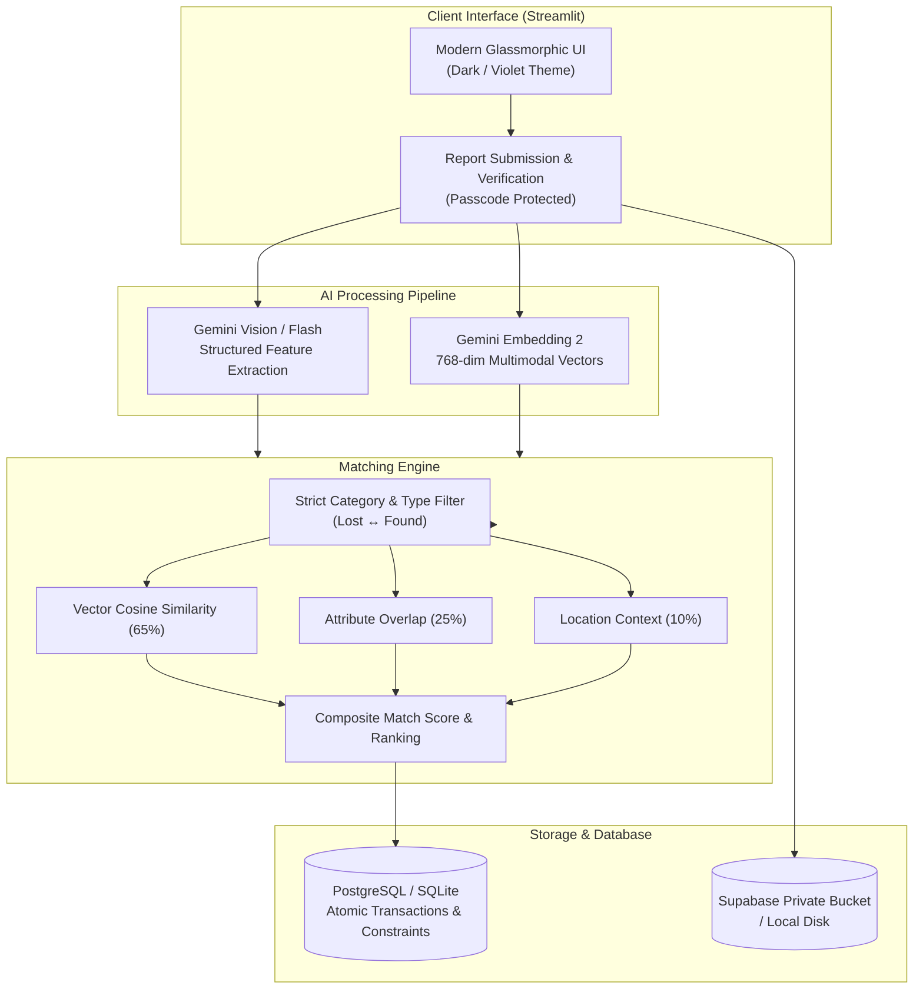

# 🔍 FINDR — AI-Powered Campus Lost & Found Platform

<p align="center">
  
  
  
  
  
</p>

<p align="center">
  <b>An intelligent, multimodal lost-and-found system fusing Computer Vision, Semantic Embeddings, and Human Verification.</b>
</p>

---

## 🌟 Overview

**FINDR** bridges the gap between misplaced possessions and their rightful owners across campus communities. By pairing **Gemini 3.8 Flash** for structured visual feature extraction with **Gemini Embedding 2** for 768-dimensional joint multimodal semantics, FINDR automates lost-to-found discovery with precision and reliability.

Designed with an elegant dark violet glassmorphic aesthetic, FINDR delivers enterprise-grade integrity, sub-second matching, and safe public exhibition controls.

---

## ⚡ Key Highlights

- 👁️ **Multimodal Visual Intelligence**: Zero-shot structured attribute extraction (colors, materials, brand emblems, unique damage/scratches, condition) using Google Gemini.
- 📐 **Hybrid Matching Engine**: 
  - **65%** Multimodal joint vector cosine similarity (`gemini-embedding-2`)
  - **25%** Structured visual metadata overlap (brand, materials, features)
  - **10%** Location and spatial context matching
  - *Dynamic weight renormalization* when images or metadata are partially provided.
- 🔒 **Enterprise Data Integrity**: Atomic cross-table transactions, row-level locks, and strict database constraints preventing double-claims and duplicate candidate records.
- 🛡️ **Dual-Engine Architecture**: Operates locally with zero cloud dependencies using SQLite (WAL mode), or scales seamlessly to **Supabase PostgreSQL** and **Private Bucket Storage** with signed time-limited URLs.
- 🎓 **Exhibition & Privacy Protection**: Public visitor mode allows live browsing and AI exploration, while reporting and private contact handoffs remain secured behind verified passcodes.

---

## 🏗️ Architecture



---

## 📂 Project Structure

```text
FINDR/
├── app.py                # Main interactive Streamlit application & routing
├── ai_engine.py          # Google Gemini multimodal vision & embedding extraction
├── matcher.py            # Cosine similarity calculation & composite ranking pipeline
├── database.py           # Unified database adapter (Supabase PostgreSQL + SQLite)
├── storage.py            # Media storage engine (Private Supabase Storage + Local disk)
├── ui_components.py      # Glassmorphic UI components, cards, banners, and badges
├── config.py             # Centralized environment & secret configuration
├── requirements.txt      # Production runtime dependencies
└── .streamlit/
    └── config.toml       # Streamlit theme custom styling and server parameters
```

---

## 🚀 Quickstart

### 1. Clone & Setup Environment

```bash
git clone https://github.com/kazukazu7877/FINDR.git
cd FINDR

# Create virtual environment
python -m venv .venv

# Activate virtual environment (Windows PowerShell)
.\.venv\Scripts\Activate.ps1
# Or on Linux / macOS:
# source .venv/bin/activate
```

### 2. Install Dependencies

```bash
pip install --upgrade pip
pip install -r requirements.txt
```

### 3. Configure API Credentials

Set the following environment variables (or add them to Streamlit Cloud Secrets):

| Variable | Description | Default / Required |
|---|---|---|
| `GEMINI_API_KEY` | Google AI Studio API key | **Required** |
| `EXHIBITION_ACCESS_CODE` | Passcode protecting report submissions & claims | Optional (default: `findr-dev-code`) |
| `DATABASE_URL` | Supabase PostgreSQL Connection String | Optional (falls back to local SQLite) |
| `SUPABASE_URL` | Supabase project endpoint | Optional (falls back to local storage) |
| `SUPABASE_SERVICE_ROLE_KEY` | Supabase service key for private storage | Optional |

### 4. Launch the App

```bash
streamlit run app.py
```

Visit `http://localhost:8501` to view the application.

---

## 🎯 Verification & Safety Flow

1. **Lost / Found Item Reported**: Image is ingested and processed concurrently for semantic embeddings and detailed JSON descriptors.
2. **Instant Match Suggestions**: Matches above threshold are queued for both parties with transparent sub-score breakdowns.
3. **Double-Blind Verification**: Claimants confirm specific matching features (e.g. inner initials, serial number, subtle marks).
4. **Resolution Lock**: Upon mutual confirmation, the status transitions to `resolved` within an atomic transaction.

---

## 📄 License

Distributed under the MIT License. See `LICENSE` for details.
